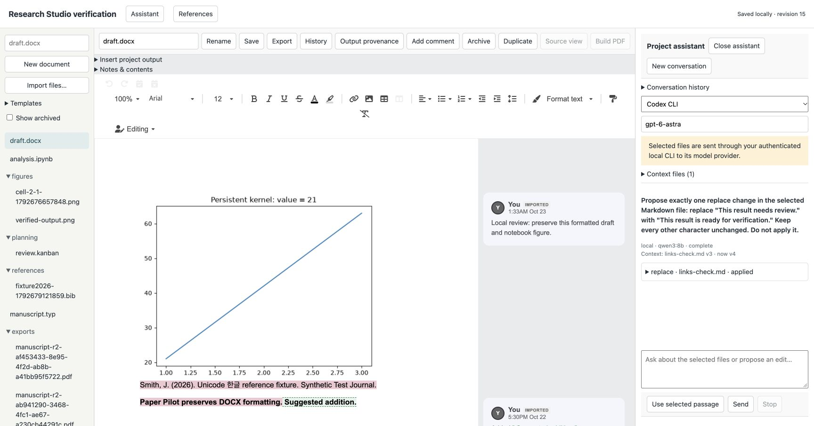
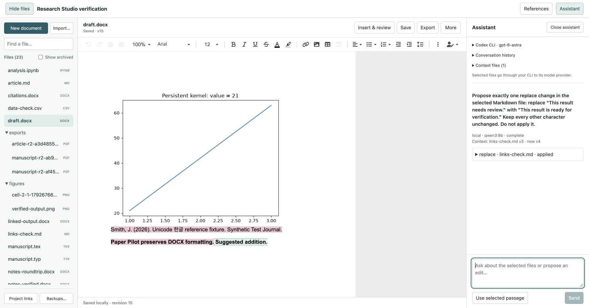

# Research Studio implementation contract

Status: implementation in progress. This is the local delivery target, not a
shipped feature list. The baseline is the public [Papers AI features](https://papers.ai/#features)
and the user's request for editable DOCX and the wider research workflow.
On 2026-10-22 the user narrowed implementation to capabilities that run locally.
Hosted collaboration, cloud sync, invitations/roles, presence, remote account
connectors and OpenRouter integration are deferred. No server deployment is part
of this implementation. Local CLI tools can still contact their configured model
providers, and compilers may download missing packages; local editing has no
account or network dependency.

## Product boundary

Research Workspace remains the project and evidence authority. A project's
**Write & run** window contains its documents, data, notebooks, references and
project conversation. The PDF reader remains a compact reading surface. No
document conversion is called lossless without a round-trip fixture proving it.

Use an existing DOCX engine rather than building Word layout or flattening DOCX
to Markdown. SuperDoc 1.47.2 (AGPL-3.0) is pinned and bundled locally, with
telemetry disabled. Its v2 successor requires a separately proprietary engine;
that dependency is excluded. The editor workspace isolates its PDF.js peer
from Paper Pilot’s existing PDF extraction dependency. Its browser UI runs in a sandboxed document;
privileged Zotero operations cross a bounded, project-bound message bridge.

## Storage and review

- Documents belong to an existing project, independently of Zotero item IDs.
- Store original-format bytes, immutable versions and a revisioned manifest.
  Write a new blob first and atomically advance the manifest last. An interrupted
  save may leave an unreferenced blob but cannot publish incomplete content.
- Serialize mutations per project. A stale document revision cannot overwrite a
  newer edit. Rename, restore and archive follow the same rule. Restoration adds
  a revision; it does not erase intervening versions.
- Keep source files and older versions. Unsupported or future storage schemas
  fail visibly without rewriting them. Empty and corrupt documents are distinct.
- AI produces proposals against captured revisions. Applying a proposal is a
  separate user operation. Execution output and manuscript edits have distinct
  permissions and provenance. Code execution does not silently authorize model
  writes to arbitrary host paths.
- Document navigation waits for a confirmed save or an explicit discard choice.
  Edits made during saving stay dirty. A failed save keeps the editor available.

## Local delivery target

| Area            | Required behavior                                                                                   |
| --------------- | --------------------------------------------------------------------------------------------------- |
| Projects        | Files/folders, import/export, duplicate/template, resume, source links                              |
| DOCX            | Paginated editing, formatting, tables/images, comments, tracked changes, Word round trip            |
| Other writing   | Markdown/MyST, LaTeX and Typst editing, preview and local compilation                               |
| References      | Zotero, document/manual/BibTeX sources, styles/bibliography, local reference-file exchange          |
| AI              | Project conversation, explicit context, file operations as reviewable proposals, cancellation       |
| Providers       | Existing Codex/Claude CLIs and loopback OpenAI-compatible endpoints                                 |
| Data            | CSV/TSV/JSONL viewing, sorting/filtering/editing, original-format export                            |
| Computation     | IPYNB Python/R cells, outputs/packages, stop/restart, reproducible runs, figures/tables into drafts |
| Planning        | Kanban, labels/filtering, links/graph, separate reading and screening states                        |
| History         | Author attribution, document versions, restore, comments/review decisions                           |
| Local operation | Local persistence, offline editing/compilation, explicit offline model capability                   |
| Portability     | Project bundle exchange, local data management, explicit storage and execution locations            |

## Integration gates

1. Prove the DOCX engine's browser and native Zotero load/edit/export behavior.
2. Deliver durable project documents and first-class DOCX/Markdown editing.
3. Connect project AI, references, review and history without weakening paper
   isolation, cancellation, or exact-evidence identity.
4. Add the remaining writing/data/computation surfaces with format-specific
   capability reporting. Local code and model inference are different runtimes.
5. Complete local provider/reference connections, project bundle portability and
   runtime validation. Server-dependent features remain outside this delivery.

These gates order the local work. Bundled editing must not require a third-party
account or silently upload documents. Cloud features require a future explicit
scope change. Offline compilation depends on installed runtimes and cached
packages/templates; offline AI requires an actual local model.

## Verification

Test revision conflicts, failed manifest writes, interrupted saves, corrupt/future
data, project isolation, history restore, non-ASCII filenames and hostile paths.
Verify DOCX formatting, tables, images, comments, citations and tracked changes
separately with structural and rendered round trips. Native Zotero, actual Word,
real model/runtime runs are separate evidence layers.
Do not turn a UI control, library feature list, or mocked test into runtime proof.

## Current evidence and remaining local work

| Capability      | Implemented                                                                                                                                                                        | Evidence / remaining work                                                                                                                                                                                  |
| --------------- | ---------------------------------------------------------------------------------------------------------------------------------------------------------------------------------- | ---------------------------------------------------------------------------------------------------------------------------------------------------------------------------------------------------------- |
| Document store  | Original bytes, folders, duplicate, archive, immutable versions, conflicts, SHA-256, backups                                                                                       | Storage/failure tests; native save/reopen and table XML verified                                                                                                                                           |
| Portability     | Local project bundles with document history, conversations and historical research snapshots; atomic empty-project restore                                                         | Automated round-trip/failure tests; browser export verified; file-chooser restore is blocked by the browser upload setting; imported Zotero sources require explicit rebinding                             |
| DOCX            | Editing, formatting, comments/tracked-change surface, original-format export, reviewed AI replacements, figure/table insertion, notes and contents fields                          | Browser comments, footnote/endnote isolation, caption/list round trips and native table insertion verified; actual Word and native visual QA remain                                                        |
| Writing         | CodeMirror, sanitized Markdown, local Tectonic/Typst/MyST builds, PDF page/text preview, starter/custom templates                                                                  | Three compiler runs; MyST template reuse passed with OS network denial; native visual painting remains unresolved                                                                                          |
| References      | Manual/BibTeX/CSL JSON, Zotero snapshots/styles, Word citation fields and explicit document-wide CSL bibliography refresh                                                          | Browser APA/Vancouver field save/reopen and OOXML structure verified; actual Word and native Zotero style import remain                                                                                    |
| AI              | Local CLIs/loopback, saved-file/PDF/selection context, editable proposals/original wording/receipts, cancellation, conversation archives/resume                                    | Native OpenDataLoader + Codex PDF answer and conversation resume; browser DOCX proposal/apply and Ollama qwen3:8b query plus edited-proposal application; Claude workload blocked by account session limit |
| Data            | CSV/TSV/JSONL paging, filter/sort, typed edits, rows/columns                                                                                                                       | Round-trip tests and browser row/column add/remove, sort/filter, leading-zero and source-order checks                                                                                                      |
| Notebooks       | Persistent Python/R protocol, outputs, interrupt/restart, PNG/HTML table export, draft insertion, Jupyter output updates, execution/input provenance and stale snapshot inspection | Native Python/table-to-DOCX and browser Matplotlib/PNG-to-DOCX; real Python clear/update integration; browser edit/run/undo and draft-to-execution stale inspection passed; R runtime remains unavailable  |
| Planning        | Kanban columns/cards, labels/filter, archive, document/card/output links graph and atomic literal-link rename repair                                                               | Browser save/graph checked; general evidence graph remains separate                                                                                                                                        |
| Server features | Deferred by user on 2026-10-22                                                                                                                                                     | No cloud sync, collaboration, hosted permissions or deployment                                                                                                                                             |

Native Studio controls and file/runtime operations work in the isolated Zotero
profile. Screen captures of the Studio window are currently white, so native
visual rendering is unresolved; accessibility success is not a visual pass.
Word-field formatting is stored as CSL-rendered results with supported OOXML
source metadata. Word's own refresh uses its own style engine. Full reference
metadata remains in the original BibTeX/CSL file. Imported research snapshots are
historical records and do not become current verified source bindings.

A browser development harness is not a product server. It uses owned fixture data
and exists only to exercise packaged UI/storage/runtime code outside Zotero.

## Format-specific boundaries

- DOCX notes use separate footnote/endnote stories even when their numeric IDs
  coincide. Contents/captions use Word TOC/SEQ fields; caption-list page numbers
  are omitted. The pinned editor's endnote exporter is patched at build time,
  with an exact-one-match guard and source/license notice. Word layout and field
  refresh still require independent Word QA.
- AI replacement text is editable during review. Original model wording remains
  in history as `proposedAfter`; reviewed wording is persisted before applying
  bytes, and the existing exact-match/revision guards still apply.
- Notebook output versions can carry execution code, session/run identity,
  timestamps, source cell/output hash and the kernel's initial project snapshot.
  Inspection detects reruns, changed code/output and changed captured inputs.
  This is recorded lineage, not full reproducibility: outside files, installed
  packages and subsequent interpreter state are not captured. Cross-cell display
  updates retire the older cell's receipt rather than asserting false lineage.
- Rename/move updates literal Markdown links/reference definitions, TeX
  image/input/include/bibliography-resource paths and Typst image/read/data paths
  in the same manifest commit. Code-generated paths, extensionless TeX lookup,
  arbitrary binary links and external URLs are not inferred. Format conversion
  requires a separate operation; renaming keeps the extension. Archived bytes
  remain historical. The links graph shows these literal references, board
  relations and recorded notebook outputs, including missing targets.
- Zotero-imported citation keys can show supporting passages admitted by Research
  Workspace's source, exclusion, fingerprint and verifier gates. Opening a passage
  revalidates its exact quote against the current PDF. Bibliographic metadata by
  itself is not proof that a cited claim is supported. Imported historical
  project snapshots do not grant a current source binding.

Draft insertion history follows the exact output version and its execution
receipt. Saving a draft and its insertion receipts is atomic. Editing a draft
preserves its insertion history without claiming the objects still exist; restoring
an earlier draft restores the history known at that version. Bundle export refuses
to combine file bytes with context collected after an intervening file mutation.

## Studio navigation

The file sidebar has filename/path search, a separately scrolling list and fixed
project actions. New document opens a format/name dialog; templates are available
there. The empty workspace shows entry actions. The document header retains its
name and save state alongside Save, Export and format-appropriate primary actions.
More contains history, rename/move, duplication, archive and structured source view.
Insert & review reveals output insertion and DOCX review/structure tools. DOCX
formatting adapts to the editor container width.

Assistant and References share one side-panel position. Model/history settings
are collapsible; the assistant composer remains visible and closing the panel
preserves pending text and review edits. Escape restores focus to the opener.
Cmd/Ctrl+S saves, and Cmd/Ctrl+P focuses file search. These are window-local UI
choices; storage formats and source-evidence contracts are unchanged.

Browser UI review with synthetic project fixtures (2026-10-23):

These screenshots establish the browser layout, not native Zotero or Word
rendering. Native visual and keyboard checks remain in the runtime checklist.
