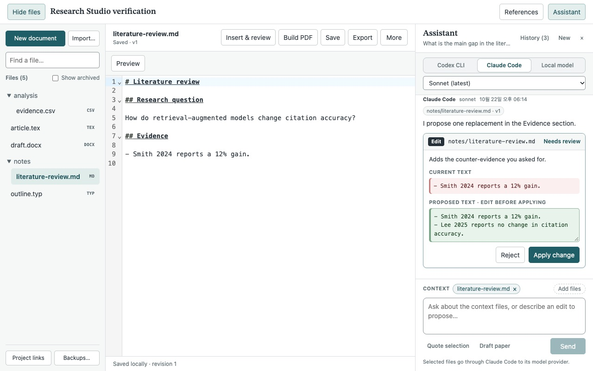
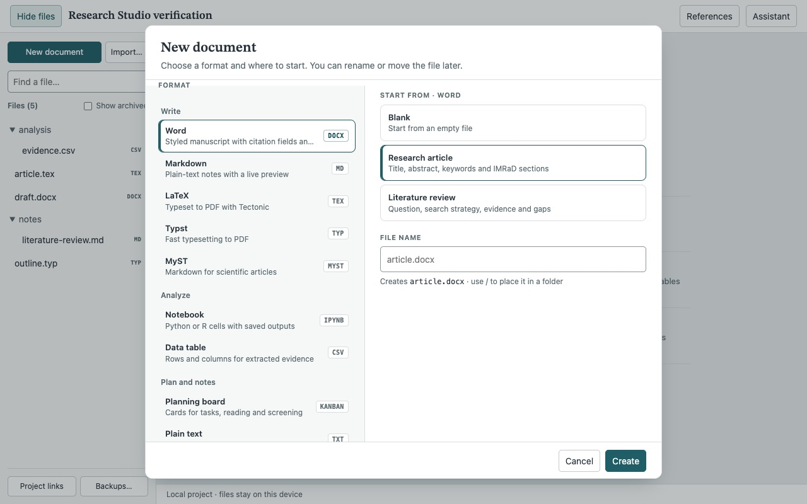

# Research Studio implementation contract

Status: implemented in source; native, provider and Word verification remains
capability-specific. The recorded evidence below is dated, and the outstanding
checks are maintained in [manual QA](./manual-qa.md#research-studio-verification).

Research Studio is local-first. Hosted collaboration, cloud sync, invitations,
roles, presence, remote account connectors and OpenRouter integration are outside
its current scope. Local CLI tools can contact their configured model providers,
and compilers may download missing packages. Local document editing has no
account or network dependency.

## Product boundary

Research Workspace remains the project and evidence authority. A project's
**Open Studio** window contains its documents, data, notebooks, references and
project conversation. The PDF reader remains a compact reading surface. No
document conversion is called lossless without a round-trip fixture proving it.

SuperDoc 1.47.2 (AGPL-3.0) is pinned and bundled locally, with telemetry
disabled. Original DOCX bytes and editor exports are versioned without flattening
the document to Markdown. The editor workspace isolates its PDF.js peer
from Paper Pilot’s existing PDF extraction dependency. Its browser UI runs in a sandboxed document;
privileged Zotero operations cross a bounded, project-bound message bridge.

## Storage and review

- Documents belong to an existing project, independently of Zotero item IDs.
- Store original-format bytes, immutable versions and a revisioned manifest.
  Write a new blob first and atomically advance the manifest last. An interrupted
  save may leave an unreferenced blob but cannot publish incomplete content.
- Serialize mutations per project. A stale document revision cannot overwrite a
  newer edit. Rename, restore and archive follow the same rule. Restoration adds
  a revision; it does not erase intervening versions.
- Keep source files and older versions. Unsupported or future storage schemas
  fail visibly without rewriting them. Empty and corrupt documents are distinct.
- AI produces proposals against captured revisions. Applying a proposal is a
  separate user operation. Execution output and manuscript edits have distinct
  permissions and provenance. Code execution does not silently authorize model
  writes to arbitrary host paths.
- Document navigation waits for a confirmed save or an explicit discard choice.
  Edits made during saving stay dirty. A failed save keeps the editor available.

Offline compilation depends on installed runtimes and cached packages/templates;
offline AI requires an actual local model. Bundled editing does not require a
third-party account or silently upload documents.

## Verification

Test revision conflicts, failed manifest writes, interrupted saves, corrupt/future
data, project isolation, history restore, non-ASCII filenames and hostile paths.
Verify DOCX formatting, tables, images, comments, citations and tracked changes
separately with structural and rendered round trips. Native Zotero, actual Word,
real model/runtime runs are separate evidence layers.
Do not turn a UI control, library feature list, or mocked test into runtime proof.

## Recorded evidence and remaining runtime checks

These observations come from the dated 2026-10-22–24 checks in manual QA. They
do not establish that every provider, format or Zotero version passes on the
current build.

| Capability      | Implemented                                                                                                                                                                        | Evidence / remaining work                                                                                                                                                                                                                                               |
| --------------- | ---------------------------------------------------------------------------------------------------------------------------------------------------------------------------------- | ----------------------------------------------------------------------------------------------------------------------------------------------------------------------------------------------------------------------------------------------------------------------- |
| Document store  | Original bytes, folders, duplicate, archive, immutable versions, conflicts, SHA-256, backups                                                                                       | Storage/failure tests; native save/reopen and table XML verified                                                                                                                                                                                                        |
| Portability     | Local project bundles with document history, conversations and historical research snapshots; atomic empty-project restore                                                         | Automated round-trip/failure tests; browser export verified; file-chooser restore is blocked by the browser upload setting; imported Zotero sources require explicit rebinding                                                                                          |
| DOCX            | Editing, formatting, comments/tracked-change surface, original-format export, reviewed AI replacements, figure/table insertion, notes and contents fields                          | Browser comments, footnote/endnote isolation, caption/list round trips and native table insertion verified; Word displayed exported text on 2026-10-24; Word save/refresh/reimport and the full native visual matrix remain                                             |
| Writing         | CodeMirror, sanitized Markdown, local Tectonic/Typst/MyST builds, PDF page/text preview, starter/custom templates                                                                  | Dated compiler runs and MyST template reuse with OS network denial passed; the 2026-10-24 environment had no compiler on PATH                                                                                                                                           |
| References      | Manual/BibTeX/CSL JSON, Zotero snapshots/styles, Word citation fields and explicit document-wide CSL bibliography refresh                                                          | Browser APA/Vancouver field save/reopen and OOXML structure verified; Word field refresh and native Zotero style import remain                                                                                                                                          |
| AI              | Local CLIs/loopback, saved-file/PDF/selection context, editable proposals/original wording/receipts, cancellation, conversation archives/resume                                    | Native OpenDataLoader + Codex PDF answer and conversation resume; browser DOCX proposal/apply and Ollama qwen3:8b query plus edited-proposal application; a later 2026-10-24 Claude sonnet workload returned selected text; new picker provider runs remain separate QA |
| Data            | CSV/TSV/JSONL paging, filter/sort, typed edits, rows/columns                                                                                                                       | Round-trip tests and browser row/column add/remove, sort/filter, leading-zero and source-order checks                                                                                                                                                                   |
| Notebooks       | Persistent Python/R protocol, outputs, interrupt/restart, PNG/HTML table export, draft insertion, Jupyter output updates, execution/input provenance and stale snapshot inspection | Native Python/table-to-DOCX and browser Matplotlib/PNG-to-DOCX; real Python clear/update integration; browser edit/run/undo and draft-to-execution stale inspection passed; R runtime remains unavailable                                                               |
| Planning        | Kanban columns/cards, labels/filter, archive, document/card/output links graph and atomic literal-link rename repair                                                               | Browser save/graph checked; general evidence graph remains separate                                                                                                                                                                                                     |
| Server features | Outside the current local scope                                                                                                                                                    | No cloud sync, collaboration, hosted permissions or deployment                                                                                                                                                                                                          |

Native Workspace and Studio painted successfully in the 2026-10-24 audit,
superseding the earlier white captures on that machine. The subsequent assistant
and New document changes have browser evidence only; their final native visual
and keyboard checks remain open. Word displayed an exported synthetic DOCX, but
a license restriction prevented Word-side editing, saving and field refresh.
Word-field formatting is stored as CSL-rendered results with supported OOXML
source metadata. Word's own refresh uses its own style engine. Full reference
metadata remains in the original BibTeX/CSL file. Imported research snapshots are
historical records and do not become current verified source bindings.

A browser development harness is not a product server. It uses owned fixture data
and exists only to exercise packaged UI/storage/runtime code outside Zotero.

## Format-specific boundaries

- DOCX notes use separate footnote/endnote stories even when their numeric IDs
  coincide. Contents/captions use Word TOC/SEQ fields; caption-list page numbers
  are omitted. The pinned editor's endnote exporter is patched at build time,
  with an exact-one-match guard and source/license notice. Word layout and field
  refresh still require independent Word QA.
- AI replacement text is editable during review. Original model wording remains
  in history as `proposedAfter`; reviewed wording is persisted before applying
  bytes, and the existing exact-match/revision guards still apply.
- Notebook output versions can carry execution code, session/run identity,
  timestamps, source cell/output hash and the kernel's initial project snapshot.
  Inspection detects reruns, changed code/output and changed captured inputs.
  This is recorded lineage, not full reproducibility: outside files, installed
  packages and subsequent interpreter state are not captured. Cross-cell display
  updates retire the older cell's receipt rather than asserting false lineage.
- Rename/move updates literal Markdown links/reference definitions, TeX
  image/input/include/bibliography-resource paths and Typst image/read/data paths
  in the same manifest commit. Code-generated paths, extensionless TeX lookup,
  arbitrary binary links and external URLs are not inferred. Format conversion
  requires a separate operation; renaming keeps the extension. Archived bytes
  remain historical. The links graph shows these literal references, board
  relations and recorded notebook outputs, including missing targets.
- Zotero-imported citation keys can show supporting passages admitted by Research
  Workspace's source, exclusion, fingerprint and verifier gates. Opening a passage
  revalidates its exact quote against the current PDF. Bibliographic metadata by
  itself is not proof that a cited claim is supported. Imported historical
  project snapshots do not grant a current source binding.

Draft insertion history follows the exact output version and its execution
receipt. Saving a draft and its insertion receipts is atomic. Editing a draft
preserves its insertion history without claiming the objects still exist; restoring
an earlier draft restores the history known at that version. Bundle export refuses
to combine file bytes with context collected after an intervening file mutation.

## Studio navigation

The file sidebar has filename/path search, a separately scrolling list and fixed
project actions. New document opens a dialog with three choices: a format grouped
by purpose (Write, Analyze, Plan and notes), a starting point for that format, and
a file name. Starting points are Blank, the built-in templates of that format and
the project's own `templates/` files with the same extension. Built-in DOCX
templates are outlines that become Title, Heading and Normal paragraphs. Typing a
known extension selects that format, and a preview line shows the exact file that
Create makes. More → Save as template copies the saved version of an open document
into `templates/`. The empty workspace shows entry actions. The document header
retains its name and save state alongside Save, Export and format-appropriate
primary actions. More contains history, rename/move, duplication, template saving,
archive and structured source view. Insert & review reveals output insertion and
DOCX review/structure tools. DOCX formatting adapts to the editor container width,
and the page is centered on the canvas.

Assistant and References share one side-panel position. The assistant's provider
switch (Codex CLI, Claude Code, Local model) and model list stay visible above the
conversation. The first choice is the provider and model of the conversation's
latest question; otherwise the project's default engine, then the reader's default
mode. Model lists come from the reader's allowed-model preferences, with an
"Other model" entry for any identifier. History lists the open conversation and
archives by last activity; choosing an archive resumes it and archives the open
one. Context files appear as removable chips above the composer, with the open
document offered as a one-click addition. While a provider runs, the transcript
shows the question with an elapsed time and Stop. Pending proposals open as cards
with current and proposed text; applied and rejected ones stay collapsed. Closing
the panel preserves pending text and review edits. Escape closes the innermost
open part (context picker, then history, then the panel) and restores focus to the
opener. Cmd/Ctrl+Enter sends, Cmd/Ctrl+S saves, and Cmd/Ctrl+P focuses file search.
These are window-local UI choices; storage formats and source-evidence contracts
are unchanged.

Browser screenshots of synthetic projects (2026-10-24):

These captures show Chrome rendering. Native Zotero uses Firefox; its visual and
keyboard checks remain in the [runtime checklist](./manual-qa.md#research-studio-verification).
